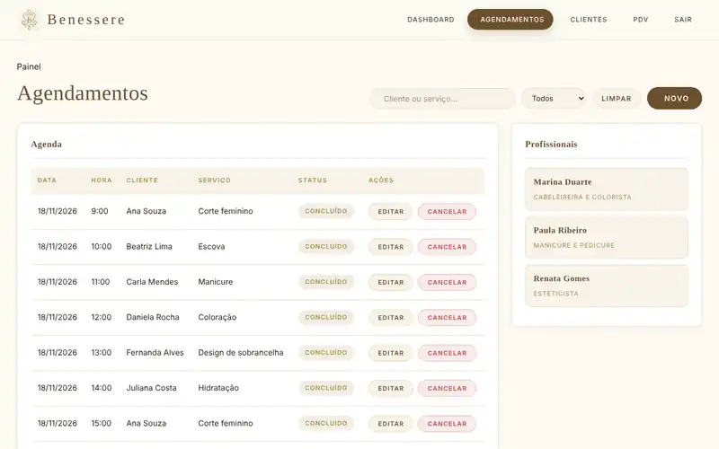

# Benessere

Sistema web de agendamento para salões de beleza, com **área do cliente** (cadastro, agendamento e histórico) e **painel administrativo** (agenda, clientes, profissionais, faturamento e ponto de venda). O nome vem do italiano *benessere*, "bem-estar".

**Demonstração:** [benessere-ssg3.vercel.app](https://benessere-ssg3.vercel.app)


## Telas

> Imagens geradas com dados de exemplo.

| Página inicial | Agendamento (cliente) |
| --- | --- |
|  |  |

**Agenda do salão (administrador)**



## Funcionalidades

**Área do cliente**
- Cadastro e login
- Escolha do profissional e do serviço, com consulta dos horários livres do dia
- Lista dos próprios agendamentos, com opção de cancelar
- Edição do perfil

**Painel administrativo**
- Dashboard com clientes ativos, agendamentos do dia e faturamento do mês
- Agenda com busca por cliente ou serviço e filtro por status
- Cadastro de profissionais e dos serviços que cada um oferece
- Lista de clientes
- Ponto de venda (PDV)
- Relatório de faturamento por mês

## Tecnologias

| Camada | Tecnologia |
| --- | --- |
| Front-end | HTML, CSS e JavaScript puro (sem framework) |
| Back-end | Node.js, Express |
| Banco de dados | MySQL (driver `mysql2` com pool de conexões) |
| Autenticação | JWT (`jsonwebtoken`) e senhas com hash `bcrypt` |
| Hospedagem | Vercel (API como função serverless em `api/index.js`) |
| Containers | Dockerfile para o back-end |

## Arquitetura

```
Navegador (HTML/CSS/JS)
        │  fetch /api/...
        ▼
Express (backend/server.js)
  ├── middleware/auth.js      verificação do token JWT
  └── routes/
      ├── auth.js             login de cliente e admin, cadastro
      ├── appointments.js     criar, listar, cancelar, horários livres
      ├── professionals.js    profissionais e seus serviços
      ├── services.js         catálogo de serviços
      ├── clients.js          perfil do cliente
      └── admin.js            dashboard, usuários, faturamento
        │
        ▼
MySQL  (users, admins, professionals, services,
        professional_services, appointments)
```

```
Benessere/
├── api/index.js        entrada da função serverless na Vercel
├── backend/
│   ├── server.js       configuração do Express e registro das rotas
│   ├── database/       pool de conexões MySQL
│   ├── middleware/     autenticação
│   └── routes/         rotas da API REST
└── public/             páginas, estilos e scripts do front-end
```

## Principais endpoints

| Método | Rota | Descrição |
| --- | --- | --- |
| POST | `/api/auth/login-cliente` | Login de cliente |
| POST | `/api/auth/login-admin` | Login de administrador |
| POST | `/api/auth/cadastro-cliente` | Cadastro de cliente |
| GET | `/api/professionals` | Profissionais com seus serviços |
| GET | `/api/appointments/horarios-disponiveis/:professionalId/:date` | Horários livres |
| POST | `/api/appointments/criar` | Novo agendamento |
| PUT | `/api/appointments/cancelar/:id` | Cancelar agendamento |
| GET | `/api/admin/dashboard` | Números do dashboard |
| GET | `/api/admin/faturamento/:mes/:ano` | Faturamento do mês |
| GET | `/api/health` | Status da API |

## Como executar

**Pré-requisitos:** Node.js 18+ e um banco MySQL 8 com as tabelas do sistema.

```bash
git clone https://github.com/shandriasarah/benessere.git
cd benessere/Benessere
npm install
```

Crie um arquivo `.env` na pasta `Benessere/`:

```env
DB_HOST=localhost
DB_PORT=3306
DB_USER=root
DB_PASSWORD=sua_senha
DB_NAME=benessere
JWT_SECRET=uma_chave_secreta
```

Inicie o servidor:

```bash
npm start
```

A API sobe em `http://localhost:3000`. Abra as páginas de `Benessere/public/` no navegador (por exemplo, com a extensão Live Server do VS Code).

## Autora

Desenvolvido por **Sarah Shandria**, estudante de Ciência da Computação.

[LinkedIn](https://www.linkedin.com/in/sarah-shandria-727b86376/) · [GitHub](https://github.com/shandriasarah)
